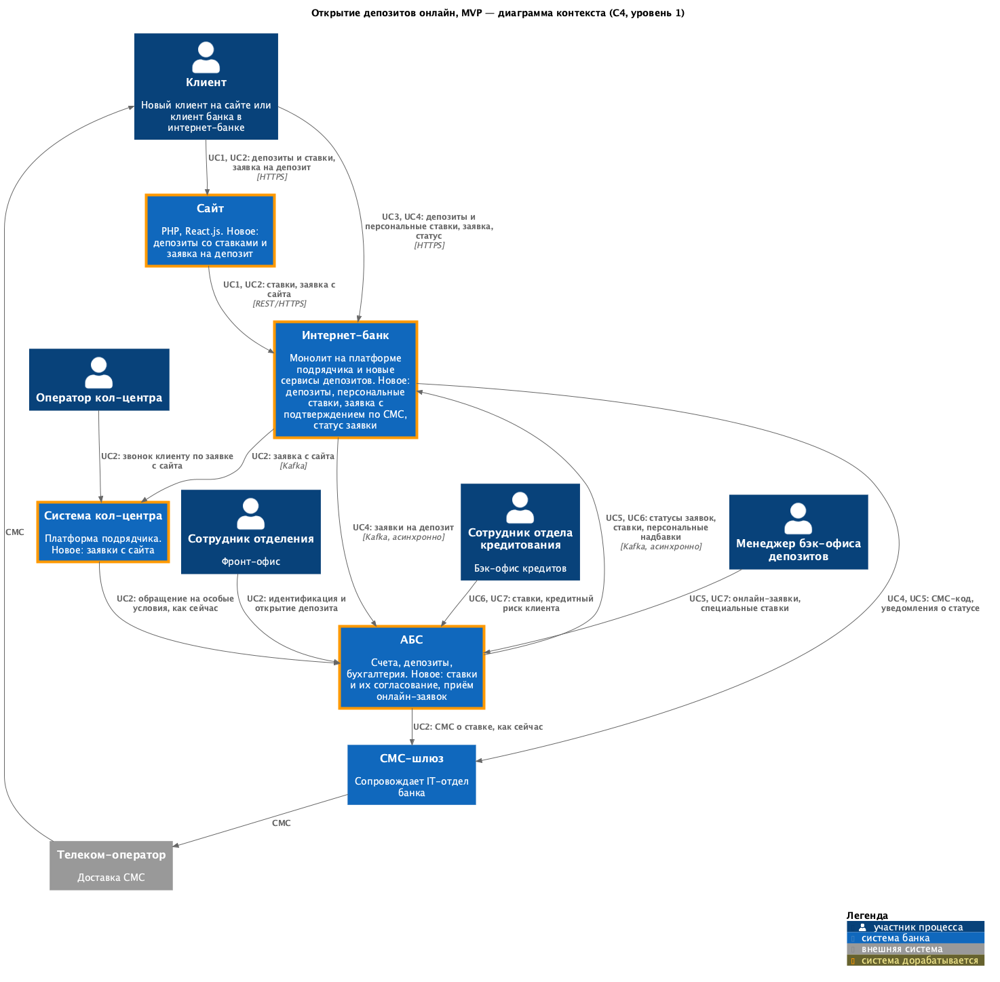
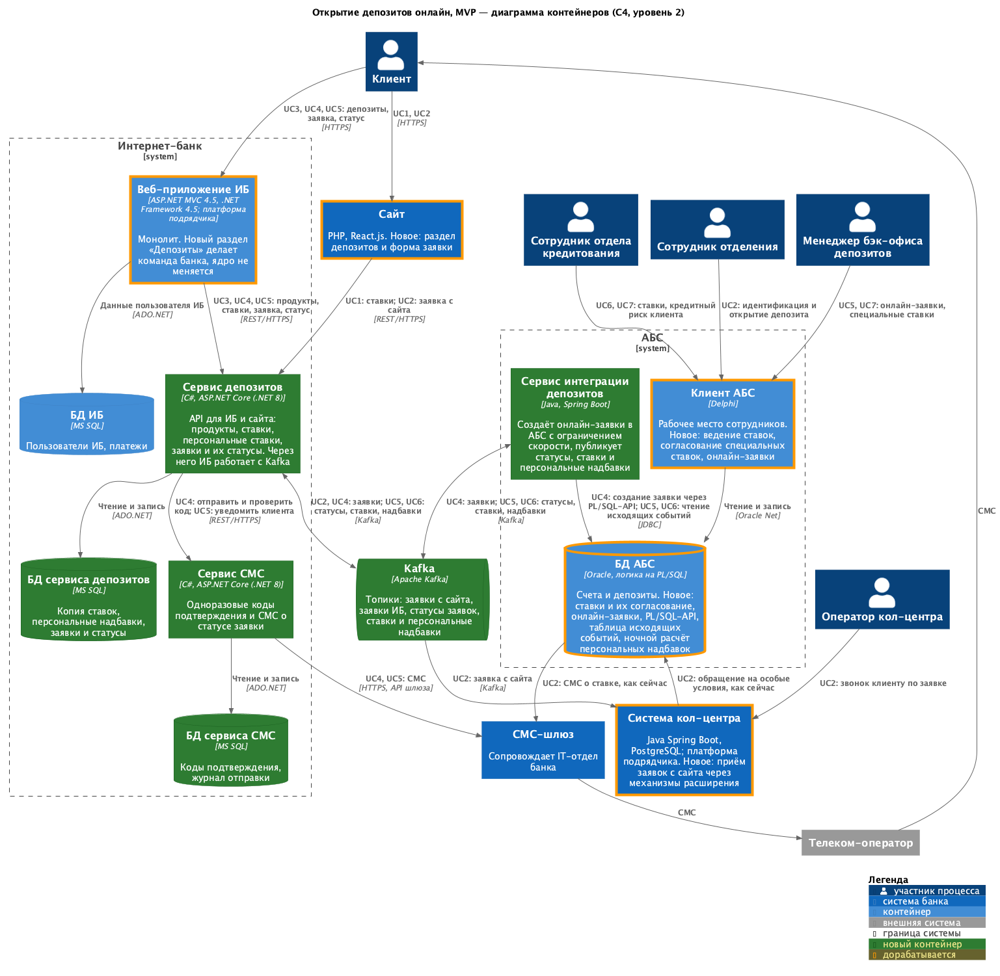

### **Название задачи:** ST-ADR1. MVP: открытие депозитов и накопительных счетов онлайн
### **Автор:** Евгений Варшавский
### **Дата:** 16.11.2026
### **Функциональные требования**
Use Cases описывают основной поток MVP: клиент подаёт заявку на депозит на сайте и в интернет-банке (ИБ), бэк-офис обрабатывает её по старому процессу. Коды под названием Use Case — требования из таблицы FURPS+ задания 2.

|**№**|**Действующие лица или системы**|**Use Case**|**Описание**|
| :-: | :- | :- | :- |
|UC1|Клиент, Сайт, Сервис депозитов|Просмотр депозитов и ставок на сайте F1|1. Клиент открывает раздел «Депозиты» на сайте. 2. Сайт запрашивает у сервиса депозитов список депозитов и актуальные ставки. 3. Сервис депозитов отдаёт их из своей копии ставок, не обращаясь к АБС. 4. Сайт показывает список клиенту.|
|UC2|Клиент, Сайт, Сервис депозитов, Kafka, Система кол-центра, Оператор кол-центра, АБС, Сотрудник отделения|Заявка на депозит на сайте F2, F3, F4|1. Клиент выбирает депозит и оставляет Ф. И. О. и номер телефона. 2. Сайт передаёт заявку в сервис депозитов. Тот сохраняет её и публикует событие в Kafka. 3. Система кол-центра получает событие и создаёт обращение. 4. Оператор звонит клиенту и рассказывает об условиях. Если клиенту положены особые условия, обращение уходит в АБС, как сейчас: бэк-офис согласует ставку (UC7), а АБС отправляет клиенту СМС. 5. Клиент приходит в отделение. Сотрудник отделения проверяет документы и открывает депозит в АБС.|
|UC3|Клиент, Интернет-банк, Сервис депозитов|Просмотр депозитов, накопительных счетов и персональных ставок в ИБ F5|1. Клиент входит в ИБ и открывает раздел «Депозиты». 2. ИБ запрашивает у сервиса депозитов продукты, ставки и персональные надбавки клиента. 3. Сервис депозитов отдаёт их из своей БД. Персональные надбавки АБС рассчитывает ночью и присылает через Kafka (UC6). 4. ИБ показывает список с персональными ставками.|
|UC4|Клиент, Интернет-банк, Сервис депозитов, Сервис СМС, СМС-шлюз, Kafka, Сервис интеграции депозитов, АБС|Заявка на депозит в ИБ с подтверждением по СМС F6, F7, F8|1. Клиент выбирает депозит или накопительный счёт, счёт списания и сумму. 2. ИБ передаёт заявку в сервис депозитов. Тот сохраняет её и просит сервис СМС отправить код. 3. Сервис СМС отправляет код через СМС-шлюз. 4. Клиент вводит код. Сервис депозитов проверяет его через сервис СМС и публикует заявку в Kafka. 5. Сервис интеграции депозитов читает заявку и создаёт её в АБС через PL/SQL-API с ограниченной скоростью. 6. Клиент видит в ИБ заявку со статусом «На рассмотрении».|
|UC5|Менеджер бэк-офиса депозитов, АБС, Сервис интеграции депозитов, Kafka, Сервис депозитов, Сервис СМС, Клиент|Обработка заявки бэк-офисом и уведомление клиента F8, F10, F16|1. Менеджер видит онлайн-заявку в АБС и подтверждает ставку. 2. АБС записывает смену статуса в таблицу исходящих событий. 3. Сервис интеграции депозитов публикует новый статус в Kafka. 4. Сервис депозитов обновляет статус заявки, а сервис СМС отправляет клиенту СМС о подтверждённой ставке. 5. Менеджер открывает депозит в АБС. Шаги 2–4 повторяются: клиент получает СМС об открытии депозита и видит депозит в ИБ.|
|UC6|Сотрудник отдела кредитования, АБС, Сервис интеграции депозитов, Kafka, Сервис депозитов|Ведение ставок в АБС и передача их в онлайн-каналы F9, F18, P5|1. Сотрудник отдела кредитования каждый день вводит ставки по депозитам в АБС вместо Excel-файла. 2. Ставки видят и сотрудники депозитов, а данные о кредитном риске клиентов — только сотрудники кредитования. 3. АБС записывает изменение ставок в таблицу исходящих событий. Туда же ночное задание АБС записывает персональные надбавки клиентов ИБ. 4. Сервис интеграции депозитов публикует ставки и надбавки в Kafka. 5. Сервис депозитов обновляет свою копию. Сайт и ИБ показывают новые ставки не позднее чем через 5 минут.|
|UC7|Менеджер бэк-офиса депозитов, Сотрудник отдела кредитования, АБС|Согласование специальной ставки F9, F18|1. Для клиента с крупными остатками менеджер депозитов создаёт в АБС запрос специальной ставки. 2. Сотрудник отдела кредитования видит запрос в своём разделе АБС, оценивает кредитный риск по клиенту и вносит вывод. 3. Менеджер депозитов видит только вывод, без кредитных данных клиента, и утверждает ставку в АБС. 4. Ставка попадает в заявку или обращение клиента, дальше процесс идёт по UC5 или UC2.|
### **Нефункциональные требования**
Из таблицы FURPS+ задания 2 взяты требования групп R, P и +R, которые влияют на архитектуру открытия депозитов. Коды совпадают с заданием 2.

|**№**|**Требование**|
| :-: | :- |
|R1|Режим работы 24/7, доступность всех сервисов 99,9%: не больше 8 ч 46 мин простоя в год|
|R2|ИБ и новые сервисы остаются доступны при сбое ЦОД и выдерживают требуемую нагрузку|
|R3|Подтверждённая заявка не теряется и не дублируется, даже если АБС или СМС-шлюз недоступны или перегружены|
|P1|Отклик по операциям сайта и ИБ — миллисекунды: 95% запросов быстрее 500 мс|
|P2|Сервисы масштабируются горизонтально, запросы распределяются между серверами, приложениями и ЦОД|
|P5|Новая ставка появляется на сайте и в ИБ не позднее чем через 5 минут после изменения|
|+R1|Используются технологии банка (MS SQL, Oracle, PostgreSQL). Новые технологии — только те, по которым в банке есть экспертиза: .NET у команды ИБ, Java у команды АБС, Python в скоринге|
|+R2|Брокер сообщений — Kafka. Платформа ИБ с Kafka несовместима, поэтому ИБ работает с ней через отдельный сервис|
|+R3|Ядро ИБ не дорабатывается. СМС-подтверждение и новая функциональность делаются вне ядра|
|+R5|Функциональность депозитов — отдельные сервисы рядом с монолитом ИБ. Они не хранят состояние на сервере и масштабируются горизонтально|
|+R6|В новых процессах ИБ и сайт не работают с АБС напрямую: её БД перегружена, а масштабируется АБС только вертикально|
|+R7|Ставки ведутся в одной системе, а онлайн-каналы читают их копию вне АБС|
|+R10|Обмен с АБС асинхронный, через Kafka: доставка гарантирована, повторная обработка не создаёт дублей|
|+R11|Сайт и ИБ вызывают новые сервисы по REST поверх HTTPS, изменения рассылаются событиями через Kafka|
|+R13|Все СМС отправляются через СМС-шлюз банка|
|+R14|Два ЦОД: новые сервисы работают в обоих, монолит ИБ на время MVP — в одном ЦОД с переключением на резервный|
|+R15|Персональные данные клиентов хранятся только в инфраструктуре банка, по 152-ФЗ|
### **Решение**
Функциональность онлайн-депозитов выносим в новые сервисы рядом с монолитом интернет-банка. С АБС эти сервисы связаны только асинхронно: через Kafka и новый сервис интеграции депозитов на стороне АБС. Монолит ИБ и АБС меняются минимально, а онлайн-нагрузка не доходит до перегруженной БД АБС.

**Диаграмма контекста (C4, уровень 1)** — [c4_context_deposits_mvp.png](c4_context_deposits_mvp.png), исходник [c4_context_deposits_mvp.puml](c4_context_deposits_mvp.puml).

**Диаграмма контейнеров (C4, уровень 2)** — [c4_container_deposits_mvp.png](c4_container_deposits_mvp.png), исходник [c4_container_deposits_mvp.puml](c4_container_deposits_mvp.puml). Детализированы интернет-банк и АБС. Зелёные контейнеры — новые, контейнеры и системы в оранжевой рамке дорабатываются. На стрелках подписаны Use Cases, которые по ним проходят.

**Основные компоненты и интеграции**

Интернет-банк:
- **Веб-приложение ИБ** (дорабатывается). В монолите появляется раздел «Депозиты». Его делает команда банка, ядро платформы подрядчика не меняется (+R3). Раздел вызывает сервис депозитов по REST (+R11). Счета клиента для списания монолит берёт так же, как сейчас.
- **Сервис депозитов** (новый). Это API депозитов для ИБ и для сайта: продукты, ставки, персональные надбавки, заявки и их статусы.
  - Ставки и надбавки отдаёт из своей БД, поэтому отвечает быстро (P1) и не нагружает АБС (+R6, +R7).
  - Заявки сохраняет у себя и публикует в Kafka. Через этот сервис ИБ работает с Kafka (+R2).
- **Сервис СМС** (новый). Отправляет и проверяет одноразовые коды подтверждения и шлёт клиенту СМС о смене статуса заявки. Все СМС уходят через СМС-шлюз банка (+R3, +R13).
- **БД сервиса депозитов** и **БД сервиса СМС** (новые, MS SQL). Каждый сервис владеет своими данными.

**Kafka** (новая). Топики:
- `deposit.site-leads` — заявки с сайта;
- `deposit.applications` — заявки ИБ;
- `deposit.application-status` — статусы заявок;
- `deposit.rates` — ставки и персональные надбавки.

Сообщения хранятся в брокере, пока потребитель их не обработает. Поэтому заявка не теряется, даже если АБС или система кол-центра недоступны (R3, +R10).

АБС:
- **Сервис интеграции депозитов** (новый).
  - Читает заявки ИБ из Kafka и создаёт их в АБС через PL/SQL-API. Читает в заданном темпе, поэтому всплеск онлайн-заявок не перегружает БД АБС.
  - Номер заявки в АБС уникален, так что повторное сообщение дубля не создаёт (R3).
  - Раз в 30 секунд читает таблицу исходящих событий АБС и публикует в Kafka статусы, ставки и персональные надбавки (P5).
- **БД АБС** (дорабатывается). Новое:
  - таблицы ставок и запросов специальных ставок, онлайн-заявки;
  - PL/SQL-API для сервиса интеграции;
  - таблица исходящих событий: её заполняют процедуры АБС при смене статуса заявки и ставок;
  - ночное задание, которое рассчитывает персональные надбавки клиентов ИБ.
- **Клиент АБС** (дорабатывается). Новое:
  - экран ведения ставок вместо Excel-файла;
  - согласование специальной ставки между депозитами и кредитованием вместо почты (F9);
  - ролевая модель, по которой сотрудники депозитов не видят кредитных данных клиентов (F18);
  - очередь онлайн-заявок для бэк-офиса.

Другие системы:
- **Сайт** (дорабатывается). Раздел депозитов и форма заявки работают через API сервиса депозитов (F1, F2), к АБС сайт не обращается (+R6).
- **Система кол-центра** (дорабатывается). Java-специалисты команды АБС через механизмы расширения платформы добавляют приём заявок с сайта из Kafka: каждая заявка становится обращением для оператора (F2, F3, +R4). Обращения на особые условия, как и раньше, уходят из системы кол-центра в АБС.
- **СМС-шлюз и телеком-оператор** не меняются.

**Логика выбора технологий**
- **.NET 8 (ASP.NET Core) для новых сервисов ИБ.** Команда ИБ (10 человек в банке и 10 у подрядчика) пишет на .NET (+R1). Современный .NET работает с MS SQL и Kafka и запускается в контейнерах, поэтому сервисы масштабируются горизонтально (P2). Старый .NET Framework 4.5 этого не умеет, это одна из причин не писать депозиты в монолите.
- **Java и Spring Boot для сервиса интеграции.** В команде АБС есть Java-разработчики (+R1), а с Oracle сервис работает через JDBC. Сервис относится к АБС: его владелец — команда АБС, которая знает её данные и ограничения нагрузки.
- **MS SQL для БД новых сервисов ИБ** — СУБД, которая уже есть у команды ИБ (+R1).
- **Kafka для обмена с АБС и системой кол-центра.** Kafka выбрал бизнес (+R2). Асинхронный обмен развязывает онлайн-каналы и перегруженную АБС, гарантирует доставку и позволяет АБС обрабатывать заявки в своём темпе (+R6, +R10, R3).
- **Таблица исходящих событий в АБС (шаблон Transactional Outbox).** Событие записывается в той же транзакции, что и изменение данных, поэтому изменения не теряются. Чтение раз в 30 секунд почти не нагружает БД, а новые технологии в Oracle не нужны.
- **REST поверх HTTPS для сайта и ИБ** (+R11). Монолит ИБ и PHP-сайт умеют вызывать REST, а клиенту нужен синхронный ответ. Весь трафик шифруется (F17).

**Как выполняются нефункциональные требования**
- **R1, R2, P2, +R14.** Сервис депозитов, сервис СМС и сервис интеграции не хранят состояние на сервере и работают в обоих ЦОД за балансировщиком. БД MS SQL реплицируются в резервный ЦОД (SQL Server Always On), брокеры Kafka стоят в обоих ЦОД. Монолит ИБ на время MVP остаётся в одном ЦОД с переключением на резервный (компромисс из задания 2).
- **P1.** Сайт и ИБ получают ставки и статусы из БД сервиса депозитов, синхронных вызовов АБС в запросе клиента нет.
- **P5.** Изменение ставки проходит путь «АБС → таблица событий → сервис интеграции → Kafka → сервис депозитов» за секунды, а при сбоях — за минуты.
- **R3, +R10.** Заявка сохраняется в БД сервиса депозитов до публикации и хранится в Kafka до обработки. В АБС она создаётся идемпотентно.
- **+R15.** Персональные данные хранятся только в БД сервисов внутри инфраструктуры банка.

**Как диаграммы покрывают Use Cases**
- UC1: Клиент → Сайт → Сервис депозитов → БД сервиса депозитов.
- UC2: Клиент → Сайт → Сервис депозитов → Kafka → Система кол-центра → Оператор. Особые условия — Система кол-центра → БД АБС → СМС-шлюз. Сотрудник отделения → Клиент АБС.
- UC3: Клиент → Веб-приложение ИБ → Сервис депозитов → БД сервиса депозитов.
- UC4: Клиент → Веб-приложение ИБ → Сервис депозитов → Сервис СМС → СМС-шлюз → Телеком-оператор → Клиент. Затем Сервис депозитов → Kafka → Сервис интеграции депозитов → БД АБС.
- UC5: Менеджер бэк-офиса → Клиент АБС → БД АБС → Сервис интеграции → Kafka → Сервис депозитов → Сервис СМС → Клиент.
- UC6: Сотрудник отдела кредитования → Клиент АБС → БД АБС → Сервис интеграции → Kafka → Сервис депозитов.
- UC7: Менеджер бэк-офиса депозитов и Сотрудник отдела кредитования → Клиент АБС → БД АБС.
### **Альтернативы**
1. **ИБ работает с АБС напрямую**, через API или БД, как сейчас с платежами и текущими счетами. Так быстрее всего, но онлайн-нагрузка пошла бы прямо в перегруженную БД АБС, а доступность ИБ зависела бы от АБС. Отклонено из-за +R6 и R1.
2. **Депозиты внутри монолита ИБ.** Новых сервисов не нужно, но платформа ИБ несовместима с Kafka (+R2), работа с СМС реализована в ядре (+R3), а монолит не масштабируется горизонтально (P2). Отклонено.
3. **Синхронный REST между сервисом депозитов и АБС вместо Kafka.** Проще в отладке, но при сбое или перегрузке АБС клиент не смог бы подать заявку, а всплеск заявок сразу попал бы в БД АБС. Отклонено из-за R3 и +R6.
4. **Отдельный сервис ставок вне АБС со своим веб-интерфейсом.** Нагрузка на АБС меньше, но сотрудникам понадобится новое рабочее место (U4) и вторая ролевая модель, а бизнес предлагает вести ставки в АБС. Для MVP отклонено. Вернёмся к варианту, когда будем автоматизировать открытие депозита (S2).
5. **Новые сервисы ИБ на Java.** Это один стек с сервисом интеграции, но Java знают лишь несколько специалистов команды АБС, а команда ИБ пишет на .NET. Отклонено из-за +R1.
6. **Захват изменений из журналов Oracle (CDC, например Debezium) вместо таблицы исходящих событий.** Изменения АБС не надо дорабатывать, но это новая технология без экспертизы в банке, она требует дополнительных прав и настроек Oracle и тоже нагружает БД. Отклонено из-за +R1.

**Недостатки, ограничения, риски**

- **Монолит ИБ на время MVP остаётся в одном ЦОД** — это компромисс по R2. При сбое ЦОД раздел «Депозиты» недоступен, пока ИБ переключается на резервный ЦОД, хотя новые сервисы при этом работают. Команда ИБ считает такой риск приемлемым, пока онлайн-клиентов мало.
- **Согласованность в конечном счёте.** Статус заявки и ставки в ИБ отстают от АБС на секунды, а при сбоях на минуты: клиент может видеть «На рассмотрении», когда в АБС уже есть решение.
- **Персональные надбавки считаются раз в сутки**, поэтому персональная ставка может отставать на день от изменения остатков клиента.
- **Доработки АБС** (ставки, специальные ставки, онлайн-заявки, PL/SQL-API, таблица событий) ложатся на команду АБС из 20 человек и затрагивают перегруженную БД. До разработки нужен нагрузочный тест ночного задания и PL/SQL-API.
- **Kafka для банка новая.** Нужны администрирование, мониторинг (S4) и обучение команд ИБ, АБС и подрядчика системы кол-центра, а это сроки и затраты.
- **В MVP заявки обрабатывает бэк-офис вручную.** При росте онлайн-заявок 50 менеджеров депозитов могут не успевать. Риск снимается автоматическим открытием депозита через год (S2).
- **API сервиса депозитов открыт для сайта**, значит, через форму можно слать мусорные заявки. Нужны ограничение частоты запросов и капча.
- **В новых сервисах два стека: .NET и Java.** Каждая команда пишет на своём, но мониторинг, логирование и описание API (S1, S4) надо делать по общим правилам.
