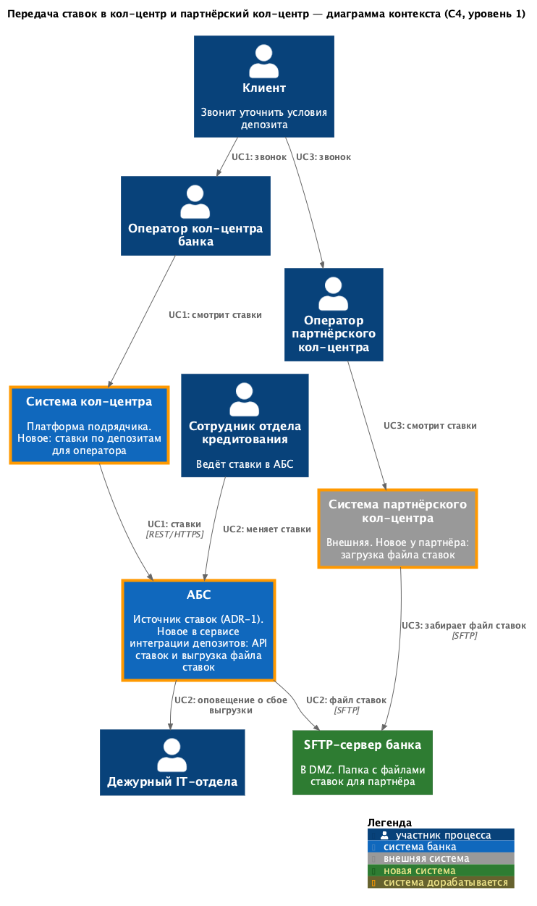
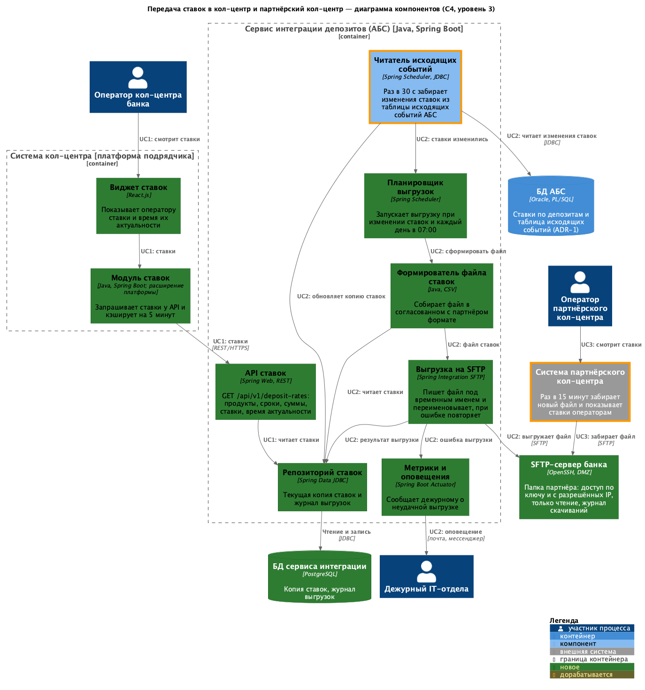
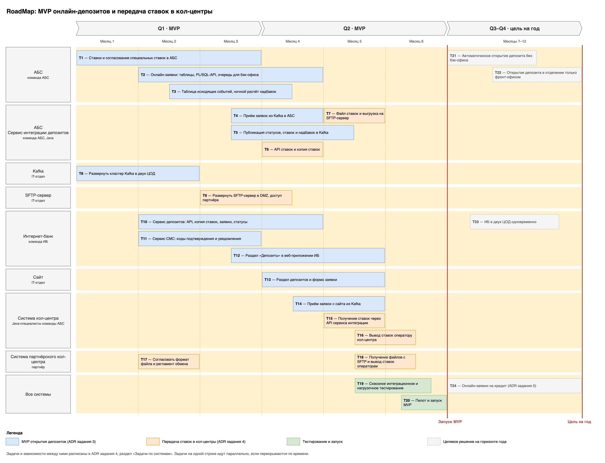

### **Название задачи:** ST-ADR2. Передача ставок по депозитам в кол-центр банка и партнёрский кол-центр
### **Автор:** Евгений Варшавский
### **Дата:** 16.11.2026
### **Функциональные требования**
После маркетинговой кампании звонков в кол-центр станет больше: пожилые клиенты захотят уточнить условия депозита по телефону. Поэтому операторы кол-центра банка и подключённого партнёрского кол-центра должны консультировать по актуальным ставкам. Партнёр работает во внешней системе и может получать ставки только файлами по SFTP, вызывать API банка он не может.

Решение строится на текущем процессе работы со ставками из ST-ADR1 (задание 3). Сотрудники ведут ставки в АБС, а сервис интеграции депозитов забирает их изменения из таблицы исходящих событий.

Новые функциональные требования продолжают нумерацию таблицы FURPS+ из задания 2:
- **F20.** Оператор кол-центра банка видит в своей системе актуальные базовые ставки по депозитам и накопительным счетам и время, на которое они актуальны.
- **F21.** Банк передаёт партнёрскому кол-центру актуальные ставки файлом по SFTP: при каждом изменении ставок и каждый день в 07:00, до начала смены.
- **F22.** Оператор партнёрского кол-центра видит актуальные ставки в системе партнёра.
- **F23.** Если файл не удалось выгрузить, дежурный IT-отдела получает оповещение. *Дополнительное:* без него партнёр может консультировать по устаревшим ставкам, и никто этого не заметит.
- **F24.** В кол-центры передаются только базовые ставки и условия продуктов, без персональных надбавок и специальных ставок. *Дополнительное:* надбавки и специальные ставки привязаны к конкретному клиенту, а оператору, особенно внешнему, его данные не нужны (F18, +R15). Особые условия по-прежнему согласует бэк-офис.

|**№**|**Действующие лица или системы**|**Use Case**|**Описание**|
| :-: | :- | :- | :- |
|UC1|Клиент, Оператор кол-центра банка, Система кол-центра, Сервис интеграции депозитов|Консультация по ставкам в кол-центре банка F20, F24|1. Клиент звонит в кол-центр, чтобы уточнить условия депозита. 2. Оператор открывает в системе кол-центра виджет «Ставки по депозитам». 3. Модуль ставок системы кол-центра отдаёт ставки из кэша. Если кэш старше 5 минут, модуль запрашивает их у API ставок сервиса интеграции депозитов. 4. Оператор видит продукты, сроки, суммы, ставки и время актуальности и консультирует клиента. 5. Если клиенту нужны особые условия, оператор заводит обращение, как в ST-ADR1 (UC2).|
|UC2|Сотрудник отдела кредитования, АБС, Сервис интеграции депозитов, SFTP-сервер банка, Дежурный IT-отдела|Выгрузка ставок для партнёрского кол-центра F21, F23, F24|1. Сотрудник отдела кредитования меняет ставки в АБС (ST-ADR1, UC6). 2. АБС записывает изменение в таблицу исходящих событий. 3. Сервис интеграции забирает изменение, обновляет свою копию ставок и формирует файл ставок. 4. Сервис выгружает файл на SFTP-сервер под временным именем и затем переименовывает его. Так партнёр никогда не увидит недописанный файл. 5. Если выгрузка не удалась, сервис повторяет её, а после трёх неудач отправляет оповещение дежурному IT-отдела. 6. Каждый день в 07:00 файл выгружается ещё раз, даже если ставки не менялись.|
|UC3|Система партнёрского кол-центра, SFTP-сервер банка, Оператор партнёрского кол-центра, Клиент|Консультация по ставкам в партнёрском кол-центре F22|1. Система партнёра раз в 15 минут подключается к SFTP-серверу банка и забирает новый файл ставок. 2. Система партнёра загружает ставки и показывает их операторам. 3. Клиент звонит в партнёрский кол-центр, и оператор консультирует его по актуальным ставкам. 4. Если клиенту нужны особые условия, оператор переводит звонок в кол-центр банка.|
### **Нефункциональные требования**
В таблице только требования групп R, P, S и +R, которые важны для этого кейса. Коды без пометки взяты из таблицы FURPS+ задания 2. Новые требования продолжают её нумерацию и помечены словом «Новое».

|**№**|**Требование**|
| :-: | :- |
|R1|Режим работы 24/7, доступность сервисов 99,9%. Относится и к API ставок|
|R4|Новое. Если API ставок недоступно, система кол-центра показывает последние полученные ставки и время их актуальности|
|R5|Новое. Выгрузка файла повторяется до успеха. На SFTP-сервере всегда лежит последний полный файл: запись идёт во временный файл, затем он переименовывается|
|P1|API ставок отвечает быстрее 500 мс в 95% запросов|
|P6|Новое. Новая ставка доступна в системе кол-центра и выложена на SFTP-сервер не позднее чем через 5 минут после изменения в АБС, так же как P5|
|P7|Новое. Партнёр забирает файл не реже раза в 15 минут: это регламент обмена с партнёром|
|S6|Новое. Формат файла описан в спецификации, согласованной с партнёром, и имеет номер версии: так формат можно менять, не ломая загрузку у партнёра|
|+R4|Систему кол-центра дорабатывают Java-специалисты команды АБС через механизмы расширения платформы|
|+R6|Ставки для кол-центров не читаются из БД АБС при каждом запросе: её БД перегружена|
|+R7|Ставки ведутся в одной системе, в АБС, а потребители получают их копию|
|+R11|Система кол-центра вызывает сервис интеграции по REST поверх HTTPS|
|+R14|Новые компоненты работают в обоих ЦОД|
|+R16|Новое. Партнёр не может вызывать API банка и получает ставки только файлами по SFTP|
|+R17|Новое. SFTP-сервер стоит в DMZ банка. Партнёр подключается по SSH-ключу с разрешённых IP-адресов и только читает свою папку. Файлы не содержат персональных данных|
### **Решение**
Ставки остаются в АБС, а раздаёт их кол-центрам сервис интеграции депозитов из ST-ADR1. Он ведёт копию ставок в своей новой БД и получает два новых выхода: REST API для системы кол-центра банка и выгрузку файла на новый SFTP-сервер банка для партнёра. Система кол-центра получает модуль и виджет ставок через механизмы расширения платформы. Партнёр сам забирает файлы с SFTP-сервера. В АБС, интернет-банке и на сайте ничего не меняется.

**Диаграмма контекста (C4, уровень 1)** — [c4_context_rates.png](c4_context_rates.png), исходник [c4_context_rates.puml](c4_context_rates.puml).

**Диаграмма компонентов (C4, уровень 3)** — [c4_component_rates.png](c4_component_rates.png), исходник [c4_component_rates.puml](c4_component_rates.puml). На ней только то, что меняется в этом кейсе: компоненты сервиса интеграции депозитов и системы кол-центра, а также SFTP-сервер. Зелёные элементы новые, элементы в оранжевой рамке дорабатываются. Компоненты сервиса интеграции, которые принимают онлайн-заявки (ST-ADR1), в этом кейсе не меняются и на диаграмме не показаны.

**Основные компоненты и интеграции**

Сервис интеграции депозитов (АБС, Java/Spring Boot):
- **Читатель исходящих событий** (дорабатывается). Раз в 30 секунд забирает изменения ставок из таблицы исходящих событий АБС, как в ST-ADR1. Новое — он обновляет копию ставок и сообщает планировщику, что ставки изменились.
- **Репозиторий ставок** и **БД сервиса интеграции** (новые, PostgreSQL). Здесь хранится текущая копия ставок и журнал выгрузок. Копия нужна, чтобы API и выгрузка не ходили в БД АБС (+R6). Её видят все экземпляры сервиса в обоих ЦОД (+R14).
- **API ставок** (новое). `GET /api/v1/deposit-rates` возвращает продукты, сроки, суммы, базовые ставки и время актуальности (F20, F24). Контракт описан в OpenAPI (S1).
- **Планировщик выгрузок** (новое). Запускает выгрузку при изменении ставок и каждый день в 07:00 (F21).
- **Формирователь файла ставок** (новое). Собирает CSV в UTF-8 по спецификации, согласованной с партнёром. В имени файла есть дата и время, в первой строке — версия формата (S6).
- **Выгрузка на SFTP** (новое). Пишет файл во временный файл и переименовывает его, при ошибке повторяет, результат записывает в журнал (R5).
- **Метрики и оповещения** (новое). Отдают метрики в мониторинг банка (S4), а после трёх неудачных попыток выгрузки оповещают дежурного IT-отдела (F23).

Система кол-центра (платформа подрядчика):
- **Модуль ставок** (новое, Java/Spring Boot, расширение платформы). Запрашивает ставки у API сервиса интеграции и кэширует их на 5 минут. Если API недоступно, отдаёт последние полученные ставки с временем актуальности (R4). Пишут модуль Java-специалисты команды АБС, ядро платформы не меняется (+R4).
- **Виджет ставок** (новое, React.js) показывает оператору ставки и время их актуальности (F20).

Остальное:
- **SFTP-сервер банка** (новое, OpenSSH в DMZ):
  - у партнёра своя папка, вход по SSH-ключу с разрешённых IP-адресов, права только на чтение (+R17);
  - сервер ведёт журнал скачиваний, по нему видно, когда партнёр забрал файл;
  - старые файлы хранятся 30 дней.
- **Система партнёрского кол-центра** (внешняя, дорабатывает партнёр). Раз в 15 минут забирает новый файл и показывает ставки операторам (F22, P7).

**Логика выбора технологий**
- **Источник ставок — АБС**, а раздаёт их сервис интеграции из ST-ADR1. Задание требует опираться на текущий процесс работы со ставками. Ставки уже ведутся в АБС (+R7), а сервис интеграции уже забирает их изменения, так что новый источник ставок не нужен.
- **REST API для кол-центра банка** (+R11). Оператору ставки нужны по запросу во время звонка, а REST-клиент с кэшем проще всего встроить в платформу через механизмы расширения (+R4).
- **Файлы по SFTP для партнёра** (+R16). Партнёр готов принимать только файлы. SFTP шифрует канал и проверяет подлинность сторон по ключам, поэтому подходит для обмена с внешней компанией.
- **SFTP-сервер на стороне банка, файлы забирает партнёр.** Банк сам управляет доступом, журналом и сроком хранения файлов. Исходящих соединений в сеть партнёра нет, а партнёр забирает файлы по своему расписанию.
- **PostgreSQL для копии ставок.** СУБД уже есть в банке (+R1), и для маленькой копии ставок и журнала выгрузок не нужна отдельная лицензия Oracle. Выделять для этого отдельный экземпляр Oracle или нагружать БД АБС не стоит.
- **CSV в UTF-8.** Такой файл загрузит любая система партнёра, а версия формата позволяет его менять (S6).
- **Spring Integration SFTP** — готовый компонент для Java-стека сервиса интеграции, свой SFTP-клиент писать не нужно.

**Как выполняются нефункциональные требования**
- **R1, +R14.** Сервис интеграции не хранит состояние на сервере и работает в обоих ЦОД. БД PostgreSQL реплицируется в резервный ЦОД. SFTP-сервер стоит в DMZ основного ЦОД, а в резервном есть копия, на которую можно переключиться.
- **R4.** Кэш в модуле ставок системы кол-центра сохраняет работу операторов, если API временно недоступно.
- **R5, F23.** Атомарное переименование, повторы и оповещения не дают партнёру получить недописанный или устаревший без предупреждения файл.
- **P1.** API читает небольшую таблицу копии ставок, а модуль ставок кэширует ответы, поэтому нагрузка от 200 операторов незначительна.
- **P6.** Изменение ставок проходит путь «АБС → таблица событий → сервис интеграции → API и SFTP» за минуту: читатель событий опрашивает таблицу раз в 30 секунд.
- **+R6, +R7.** Ни API, ни выгрузка не обращаются к БД АБС. Копию ставок обновляет только читатель исходящих событий.
- **+R17.** В файле только публичные базовые ставки, персональных данных там нет, а доступ к папке ограничен ключом, IP-адресами и правом только на чтение.

**Как диаграммы покрывают Use Cases**
- UC1: Оператор кол-центра → Виджет ставок → Модуль ставок → API ставок → Репозиторий ставок → БД сервиса интеграции.
- UC2: БД АБС → Читатель исходящих событий → Репозиторий ставок и Планировщик выгрузок → Формирователь файла ставок → Выгрузка на SFTP → SFTP-сервер банка. При сбое: Метрики и оповещения → Дежурный IT-отдела.
- UC3: Система партнёрского кол-центра → SFTP-сервер банка. Затем Оператор партнёрского кол-центра → Система партнёрского кол-центра.
### **Альтернативы**
1. **Система кол-центра читает ставки из Kafka**, из топика `deposit.rates`, как сервис депозитов ИБ. Это событийная модель без синхронной зависимости, но тогда системе кол-центра нужны своё хранилище ставок и ещё один потребитель Kafka в расширении платформы подрядчика. Для чтения ставок по запросу оператора REST с кэшем проще. Отклонено.
2. **API читает ставки прямо из БД АБС**, без своей копии. Новой БД не нужно, но каждый запрос операторов попадал бы в перегруженную БД АБС, а при её недоступности ставок не было бы ни у кого. Отклонено из-за +R6.
3. **SFTP-сервер на стороне партнёра, банк сам отправляет туда файлы.** Банку не нужно держать сервер, но появляются исходящие соединения в чужую сеть, а журнал и сроки хранения банк не контролирует. Отклонено.
4. **Отправлять ставки партнёру по почте Excel-файлом**, как сейчас внутри банка. Ничего не надо разрабатывать, но это ручная работа без гарантии доставки, и её легко забыть при изменении ставок. Отклонено.
5. **Операторы партнёра смотрят ставки на сайте банка.** Разработки почти нет, но партнёр просит файлы для своей системы и скриптов, на сайте может не быть всех условий продуктов, а партнёр зависел бы от доступности сайта. Отклонено.
6. **Дать операторам партнёра доступ к системе кол-центра банка** через VPN или удалённое рабочее место. Ставки будут одни и те же, но партнёр работает в своей системе, а доступ внешних сотрудников к внутренней системе — это риск безопасности и затраты на лицензии. Отклонено.
7. **Формировать файл ставок в АБС заданием PL/SQL.** Сервис интеграции не нужно дорабатывать, но это лишняя работа для перегруженной БД и для команды АБС, а копия ставок в сервисе интеграции нужна всё равно, для API. Отклонено.

**Недостатки, ограничения, риски**

- **Свежесть ставок у партнёра зависит от регламента партнёра.** Банк гарантирует только выгрузку файла за 5 минут. Если партнёр забирает файлы реже, его операторы называют устаревшие ставки. Нужен договор с партнёром о регламенте (P7), а по журналу SFTP-сервера проверять, как часто он забирает файлы.
- **SFTP-сервер в DMZ — новая точка атаки.** Нужны настройка безопасности сервера, смена ключей и наблюдение за журналом входов.
- **Кол-центр зависит от сервиса интеграции.** Если API недоступно дольше обычного, операторы видят кэш, то есть ставки на определённый момент. При смене ставок в это время они могут быть неактуальны.
- **Сервис интеграции растёт.** К приёму заявок из ST-ADR1 добавляются API, копия ставок и выгрузка файлов. Всё это, как и доработки системы кол-центра, делают Java-специалисты команды АБС, а их всего несколько человек. Это узкое место RoadMap: задачи T4–T7 и T14–T16 нельзя сдвигать без сдвига запуска.
- **Особые условия только через банк.** Операторы партнёра переводят таких клиентов в кол-центр банка, и для клиента путь становится длиннее.
- **Формат файла меняется только вместе с партнёром.** Изменения формата надо выпускать по согласованию с ним, иначе загрузка у партнёра сломается (S6).
- **Новая БД PostgreSQL** требует резервного копирования, репликации в резервный ЦОД и мониторинга.

### Задачи по системам
Задачи охватывают MVP из ST-ADR1 и изменения этого кейса, а также задачи цели на год. Порядок выполнения показан на RoadMap. Колонка «Зависит от» значит, что задача завершается после указанных. Начать разработку можно и раньше: контракты API, событий и файла (S1, S6) согласуются в первый месяц, а до готовности соседей разработка идёт на заглушках.

| № | Система | Задача | Откуда | Зависит от | Месяцы |
| :-: | :- | :- | :- | :- | :-: |
| T1 | АБС | Ведение ставок и согласование специальных ставок: справочник ставок, экраны, роли | ST-ADR1, UC6, UC7 | — | 1–3 |
| T2 | АБС | Онлайн-заявки: таблицы, PL/SQL-API, очередь заявок для бэк-офиса | ST-ADR1, UC4, UC5 | — | 2–4 |
| T3 | АБС | Таблица исходящих событий и ночной расчёт персональных надбавок | ST-ADR1, UC3, UC5, UC6 | T1 | 2–4 |
| T4 | Сервис интеграции депозитов | Приём заявок из Kafka и создание их в АБС | ST-ADR1, UC4 | T2, T8 | 3–4 |
| T5 | Сервис интеграции депозитов | Публикация статусов, ставок и надбавок в Kafka | ST-ADR1, UC5, UC6 | T3, T8 | 3–5 |
| **T6** | Сервис интеграции депозитов | **API ставок и копия ставок в БД сервиса** | ST-ADR2, UC1 | T1, T3 | 4 |
| **T7** | Сервис интеграции депозитов | **Формирование файла ставок, выгрузка на SFTP-сервер, оповещения о сбоях** | ST-ADR2, UC2 | T6, T9, T17 | 5 |
| T8 | Kafka | Кластер Kafka в двух ЦОД, топики, мониторинг | ST-ADR1 | — | 1–2 |
| **T9** | SFTP-сервер | **SFTP-сервер в DMZ: папка и ключ партнёра, разрешённые IP, журнал скачиваний** | ST-ADR2, UC2, UC3 | — | 3–4 |
| T10 | Интернет-банк | Сервис депозитов: API продуктов, ставок, заявок и статусов, копия ставок | ST-ADR1, UC1, UC3–UC5 | T8 | 2–4 |
| T11 | Интернет-банк | Сервис СМС: коды подтверждения и уведомления | ST-ADR1, UC4, UC5 | — | 2–3 |
| T12 | Интернет-банк | Раздел «Депозиты» в веб-приложении ИБ | ST-ADR1, UC3–UC5 | T10, T11 | 3–5 |
| T13 | Сайт | Раздел депозитов и форма заявки | ST-ADR1, UC1, UC2 | T10 | 4–5 |
| T14 | Система кол-центра | Приём заявок с сайта из Kafka | ST-ADR1, UC2 | T8, T10 | 4–5 |
| **T15** | Система кол-центра | **Модуль ставок: получение ставок через API сервиса интеграции, кэш** | ST-ADR2, UC1 | T6 | 5 |
| **T16** | Система кол-центра | **Виджет ставок для оператора** | ST-ADR2, UC1 | T15 | 5–6 |
| **T17** | Система партнёрского кол-центра | **Согласовать с партнёром формат файла и регламент обмена** | ST-ADR2, UC2, UC3 | — | 2 |
| **T18** | Система партнёрского кол-центра | **Загрузка файлов с SFTP-сервера и вывод ставок операторам (силами партнёра)** | ST-ADR2, UC3 | T7, T9, T17 | 5–6 |
| T19 | Все системы | Сквозное интеграционное и нагрузочное тестирование | S5 | T4–T7, T12–T16, T18 | 5–6 |
| T20 | Все системы | Пилот, обучение операторов, запуск MVP | — | T19 | 6 |
| T21 | АБС, сервис интеграции, сервис депозитов | Автоматическое открытие депозита без бэк-офиса | Цель на год (S2) | T20 | 7–10 |
| T22 | АБС | Открытие депозита в отделении только фронт-офисом | Цель на год | T21 | 9–12 |
| T23 | Интернет-банк | ИБ работает в двух ЦОД одновременно | Цель на год (+R14) | T20 | 8–11 |
| T24 | Интернет-банк, сайт, Кредитный конвейер, скоринг | Онлайн-заявки на кредит | Цель на год (ADR задания 5) | T20 | 7–12 |

Жирным выделены задачи этого кейса (ST-ADR2).

### RoadMap
[roadmap.drawio](roadmap.drawio) — RoadMap в draw.io по формату шаблона курса, [roadmap.png](roadmap.png) — его экспорт. Системы идут строками, задачи — плашками по месяцам. Первые 6 месяцев — MVP вместе с изменениями этого кейса, дальше — задачи цели на год.

