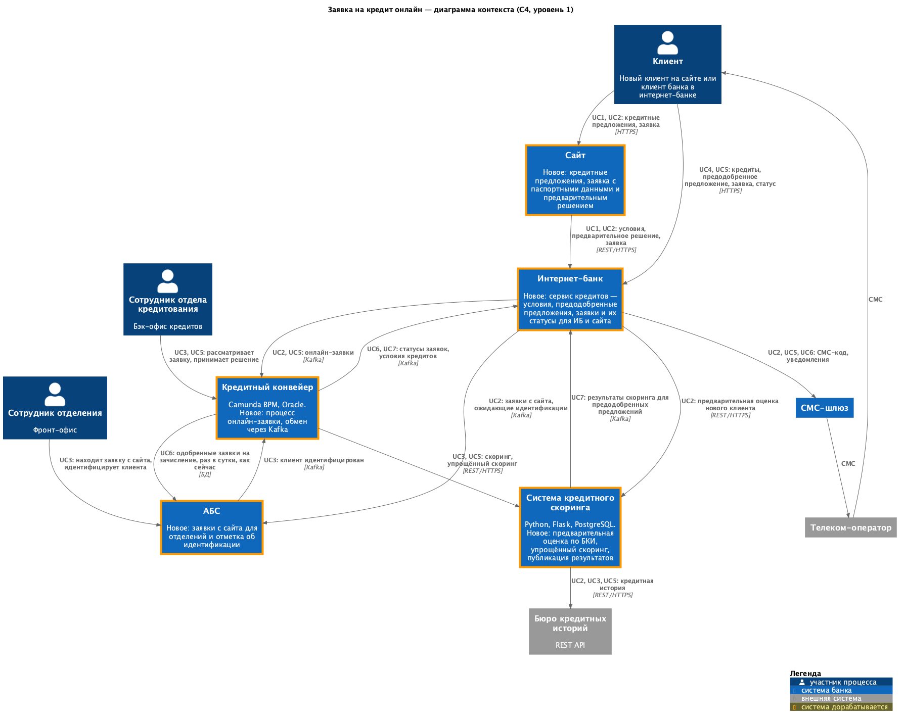
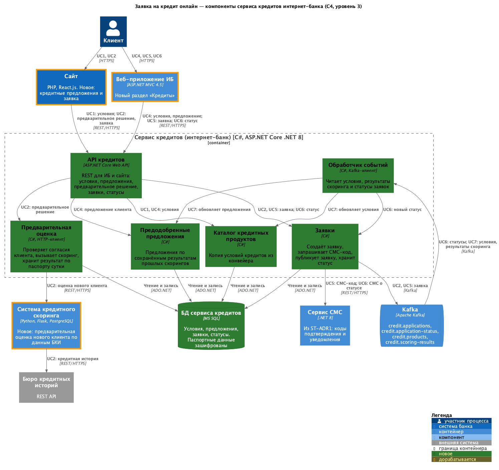
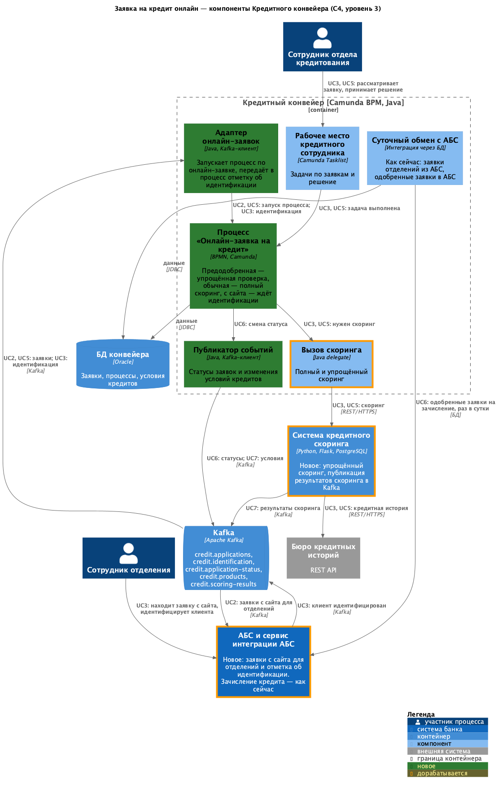

### **Название задачи:** ST-ADR3. Заявка на кредит онлайн в интернет-банке и на сайте
### **Автор:** Евгений Варшавский
### **Дата:** 16.11.2026
### **Функциональные требования**
Подачу заявки на кредит онлайн делаем в течение года после MVP депозитов. Клиент подаёт заявку в интернет-банке (ИБ) или на сайте и получает решение в течение дня, если данных для решения достаточно. Основа — кредитные требования из таблицы FURPS+ задания 2:
- F7 — подтверждение заявки СМС-кодом;
- F10 — СМС о статусах;
- F11, F12 — кредит на сайте и предварительное решение;
- F13 — продолжение заявки в отделении;
- F14, F15 — кредиты и предодобренное предложение в ИБ;
- F16 — статус заявки.

Решение опирается на ST-ADR1: сервис СМС, Kafka, сервис интеграции АБС с таблицей исходящих событий.

Новые функциональные требования продолжают нумерацию FURPS+:
- **F25.** Перед запросом в БКИ клиент на сайте даёт согласие на обработку персональных данных и на получение его кредитной истории. Без согласия предварительное решение не запрашивается, а заявка уходит без него. *Дополнительное:* закон «О кредитных историях» разрешает запрос в БКИ только с согласия клиента, а паспортные данные — персональные (+R15).
- **F26.** Если предварительное решение по тому же паспорту запрашивают повторно в течение суток, клиент получает сохранённый результат, а скоринг и БКИ не вызываются. *Дополнительное:* каждый запрос в БКИ платный и отражается в кредитной истории клиента, а скоринг в рабочие часы и так нагружен (+R8).

|**№**|**Действующие лица или системы**|**Use Case**|**Описание**|
| :-: | :- | :- | :- |
|UC1|Клиент, Сайт, Сервис кредитов|Просмотр кредитных предложений на сайте F11|1. Клиент открывает раздел «Кредиты» на сайте. 2. Сайт запрашивает у сервиса кредитов условия кредитов. 3. Сервис кредитов отдаёт их из своей копии, которую обновляет Кредитный конвейер (UC7). 4. Сайт показывает предложения со ставками.|
|UC2|Клиент, Сайт, Сервис кредитов, Система кредитного скоринга, БКИ, Kafka, Кредитный конвейер, АБС, Сервис СМС|Заявка на кредит на сайте с предварительным решением F10, F12, F25, F26|1. Клиент выбирает кредит и указывает телефон и Ф. И. О. 2. Если клиент ввёл паспортные данные и дал согласия, сервис кредитов запрашивает у скоринга предварительную оценку. Скоринг онлайн запрашивает кредитную историю в БКИ. 3. Не дольше чем через 30 секунд клиент видит предварительное решение: одобрено или нет. 4. Сервис кредитов сохраняет заявку и публикует её в Kafka. 5. Кредитный конвейер создаёт заявку со статусом «Ждёт идентификации». Сервис интеграции АБС добавляет её в список заявок с сайта, который видят отделения. 6. Клиент получает СМС с номером заявки: прийти в отделение для идентификации и получения кредита.|
|UC3|Клиент, Сотрудник отделения, АБС, Сервис интеграции АБС, Kafka, Кредитный конвейер, Система кредитного скоринга, Сотрудник отдела кредитования|Продолжение заявки с сайта в отделении F13|1. Клиент приходит в отделение. Сотрудник находит в АБС его заявку с сайта по номеру или телефону. 2. Сотрудник проверяет документы, заводит клиента в АБС и отмечает в заявке, что идентификация пройдена. 3. АБС записывает событие в таблицу исходящих событий, а сервис интеграции публикует в Kafka событие «клиент идентифицирован». 4. Конвейер продолжает ту же заявку: проводит полный скоринг и ставит задачу сотруднику отдела кредитования. 5. Сотрудник принимает решение, дальше процесс идёт по UC6. Если у клиента нет заявки с сайта, сотрудник отделения создаёт новую заявку в АБС, как сейчас.|
|UC4|Клиент, Интернет-банк, Сервис кредитов|Просмотр кредитов и предодобренного предложения в ИБ F14|1. Клиент открывает в ИБ раздел «Кредиты». 2. ИБ запрашивает у сервиса кредитов условия кредитов и предложение для клиента. 3. Сервис кредитов отдаёт условия из своей копии. Если по клиенту уже был скоринг с рассчитанной суммой, он отдаёт и предодобренное предложение (UC7). 4. ИБ показывает список кредитов и предложение с суммой.|
|UC5|Клиент, Интернет-банк, Сервис кредитов, Сервис СМС, Kafka, Кредитный конвейер, Система кредитного скоринга, БКИ, Сотрудник отдела кредитования|Заявка на кредит в ИБ F7, F15|1. Клиент выбирает кредит или предодобренное предложение и указывает счёт зачисления и данные заявки. 2. Сервис кредитов просит сервис СМС отправить код, клиент вводит код. 3. Сервис кредитов публикует заявку в Kafka, и в течение 5 минут она появляется в Кредитном конвейере. 4. По предодобренному предложению конвейер проверяет, изменилась ли ситуация клиента. Если изменилась, он запускает упрощённый скоринг. По обычной заявке проводится полный скоринг. 5. Сотрудник отдела кредитования рассматривает заявку в тот же рабочий день и принимает решение, дальше процесс идёт по UC6.|
|UC6|Кредитный конвейер, Kafka, Сервис кредитов, Сервис СМС, Клиент, АБС|Статус заявки, решение и зачисление F10, F16|1. При каждой смене статуса заявки конвейер публикует событие в Kafka. 2. Сервис кредитов обновляет статус. Клиент видит его в ИБ и получает СМС. 3. Одобренная заявка уходит из конвейера в АБС через суточный обмен, как сейчас, и АБС зачисляет кредит на счёт клиента.|
|UC7|Кредитный конвейер, Система кредитного скоринга, Kafka, Сервис кредитов|Обновление условий кредитов и предодобренных предложений F11, F14|1. Когда меняются условия кредитов, конвейер публикует их в Kafka. 2. После каждого скоринга существующего клиента скоринг публикует результат: клиента, рассчитанную сумму и дату. 3. Сервис кредитов обновляет копию условий и предодобренные предложения. Отдельных предрасчётов скоринга нет (+R8).|
### **Нефункциональные требования**
Коды без пометки взяты из таблицы FURPS+ задания 2. Новые требования продолжают её нумерацию и помечены словом «Новое».

**Нефункциональные требования**

|**№**|**Требование**|
| :-: | :- |
|R1|Режим работы 24/7, доступность сервисов 99,9%|
|R2|ИБ и новые сервисы остаются доступны при сбое ЦОД и выдерживают требуемую нагрузку|
|R3|Заявка, которую клиент подтвердил, не теряется и не дублируется, даже если конвейер, скоринг или АБС недоступны|
|R6|Новое. Если скоринг или БКИ недоступны, заявка с сайта всё равно принимается, только без предварительного решения. Решение клиент получит позже по СМС|
|P1|Условия кредитов, предложения и статусы в ИБ и на сайте отдаются быстрее 500 мс в 95% запросов|
|P2|Сервисы масштабируются горизонтально, запросы распределяются между серверами, приложениями и ЦОД|
|P3|Решение по заявке из ИБ или с сайта — в течение одного дня, если данных достаточно. Заявки по предодобренным предложениям обрабатываются в тот же рабочий день|
|P4|Предварительное решение на сайте клиент получает не дольше чем за 30 секунд|
|P8|Новое. Онлайн-заявка появляется в Кредитном конвейере не позднее чем через 5 минут после подачи|

**Архитектурно значимые требования (группа +R)**

|**№**|**Требование**|
| :-: | :- |
|+R1|Используются технологии банка, а новые — только с экспертизой в банке: .NET у команды ИБ, Java в конвейере, Python в скоринге|
|+R2|Брокер сообщений — Kafka. ИБ работает с ней через отдельный сервис|
|+R3|Ядро ИБ не дорабатывается, СМС-подтверждение делается вне ядра|
|+R4|Процессы и Java-обработчики Кредитного конвейера меняет IT-отдел банка|
|+R5|Новая функциональность ИБ делается отдельными сервисами рядом с монолитом|
|+R6|ИБ и сайт не работают с АБС напрямую|
|+R8|Скоринг не нагружается предрасчётами: предодобренные предложения строятся по сохранённым результатам прошлых скорингов|
|+R9|Онлайн-заявки на кредит передаются в Кредитный конвейер напрямую, минуя АБС и её суточный обмен|
|+R10|Обмен с АБС асинхронный, через Kafka|
|+R11|Сайт и ИБ вызывают новые сервисы по REST, изменения рассылаются событиями через Kafka|
|+R12|Предварительное решение — синхронная цепочка REST-вызовов до скоринга и БКИ: клиент ждёт ответа на странице|
|+R13|Все СМС отправляются через СМС-шлюз банка|
|+R14|Новые компоненты работают в обоих ЦОД|
|+R15|Персональные данные клиентов хранятся только в инфраструктуре банка, по 152-ФЗ|
|+R18|Новое. Паспортные данные с сайта хранятся в БД сервиса кредитов в зашифрованном виде. Если клиент не пришёл в отделение, через 30 дней они удаляются. Дополнительное: 152-ФЗ требует хранить персональные данные не дольше, чем нужно для цели обработки|
### **Решение**
Онлайн-заявки на кредит идут в Кредитный конвейер напрямую через Kafka, минуя АБС и её суточный обмен. В ИБ появляется новый **сервис кредитов** — общий бэкенд кредитов для ИБ и сайта:
- хранит копию условий кредитов и предодобренные предложения;
- получает предварительное решение для сайта;
- принимает заявки и ведёт их статусы.

Сервис СМС и Kafka берём из ST-ADR1. В Кредитном конвейере появляются процесс онлайн-заявки и обмен через Kafka, в скоринге — предварительная оценка и упрощённый скоринг. В АБС меняется только работа отделения с заявками с сайта, а зачисление кредита остаётся прежним.

**Диаграмма контекста (C4, уровень 1)** — [c4_context_credit.png](c4_context_credit.png), исходник [c4_context_credit.puml](c4_context_credit.puml).

**Диаграммы компонентов (C4, уровень 3).** Детализированы два контейнера, которые меняются сильнее всего. Зелёные элементы новые, элементы в оранжевой рамке дорабатываются.
- Сервис кредитов ИБ — [c4_component_credit_service.png](c4_component_credit_service.png), исходник [c4_component_credit_service.puml](c4_component_credit_service.puml).
- Кредитный конвейер — [c4_component_credit_conveyor.png](c4_component_credit_conveyor.png), исходник [c4_component_credit_conveyor.puml](c4_component_credit_conveyor.puml).

**Основные компоненты и интеграции**

Сервис кредитов (новый, интернет-банк, C#/.NET 8, MS SQL):
- **API кредитов** — REST для ИБ и сайта: условия, предложения, предварительное решение, заявки и статусы (+R11).
- **Каталог кредитных продуктов** — копия условий кредитов из конвейера. Её обновляют события (UC7), поэтому чтение быстрое (P1).
- **Предодобренные предложения** — строятся по результатам прошлых скорингов, которые публикует система скоринга (+R8).
- **Предварительная оценка**:
  - проверяет согласия клиента (F25) и вызывает скоринг с таймаутом 30 секунд (P4);
  - хранит результат по паспорту сутки (F26);
  - если скоринг или БКИ недоступны, пропускает предварительное решение (R6).
- **Заявки**:
  - сохраняют заявку и запрашивают СМС-код через сервис СМС (F7, +R3);
  - публикуют заявку в Kafka, через этот сервис ИБ и работает с Kafka (+R2);
  - ведут статус заявки (F16).
- **Обработчик событий** — читает из Kafka условия, результаты скоринга и статусы. При смене статуса просит сервис СМС отправить уведомление (F10).
- **БД сервиса кредитов** — паспортные данные в ней зашифрованы и удаляются через 30 дней (+R18).

Кредитный конвейер (дорабатывается, Camunda, Java; доработки делает IT-отдел, +R4):
- **Адаптер онлайн-заявок** (новый) — читает заявки из Kafka и запускает процесс. Событие «клиент идентифицирован» передаёт в ожидающий процесс через корреляцию сообщений Camunda.
- **Процесс «Онлайн-заявка на кредит»** (новый, BPMN):
  - предодобренная заявка — проверка изменений и при необходимости упрощённый скоринг;
  - обычная заявка — полный скоринг;
  - заявка с сайта ждёт идентификации в отделении.
- **Вызов скоринга** (дорабатывается) — к полному скорингу добавляется упрощённый.
- **Публикатор событий** (новый) — публикует в Kafka статусы заявок и изменения условий кредитов.
- **Рабочее место кредитного сотрудника** и **суточный обмен с АБС** не меняются: заявки отделений по-прежнему приходят из АБС, а одобренные заявки уходят в АБС на зачисление.

Остальные системы:
- **Система кредитного скоринга** (дорабатывается, Python/Flask):
  - новые REST-методы: предварительная оценка нового клиента только по данным БКИ и упрощённый скоринг;
  - после каждого скоринга существующего клиента результат публикуется в Kafka (UC7).
- **АБС и сервис интеграции АБС** (дорабатываются, приём по схеме из ST-ADR1):
  - сервис интеграции читает из Kafka заявки с сайта и через PL/SQL-API кладёт их в список заявок для отделений;
  - в клиенте АБС появляются поиск заявки с сайта и отметка об идентификации;
  - событие идентификации уходит через таблицу исходящих событий и Kafka в конвейер (+R10).
- **Сайт** (дорабатывается) — раздел кредитов, форма заявки с паспортными данными и согласиями, показ предварительного решения через API сервиса кредитов (+R6).
- **Веб-приложение ИБ** (дорабатывается) — раздел «Кредиты» без изменения ядра (+R3).

**Логика выбора технологий**
- **Отдельный сервис кредитов на .NET 8 и MS SQL.**
  - Стек тот же, что у сервиса депозитов: команда ИБ его знает (+R1), сервис работает рядом с монолитом и масштабируется горизонтально (+R5, P2).
  - С сервисом депозитов его не объединяем: у кредитов другой процесс и другая система-партнёр — конвейер, а не АБС.
  - Общее — сервис СМС, Kafka и шаблоны интеграции — используется повторно (S3).
- **Kafka между ИБ и конвейером** (+R2, +R9). Асинхронный обмен с гарантированной доставкой не теряет заявки при недоступности конвейера (R3) и доставляет их за минуты, а не за сутки (P3, P8). Конвейер масштабируется горизонтально и работает 24/7, поэтому онлайн-поток выдержит.
- **Java-адаптер и BPMN-процесс внутри конвейера.** Camunda позволяет писать обработчики на Java и менять процессы, а у IT-отдела для этого есть экспертиза (+R4). Ожидание идентификации — стандартный элемент BPMN «ожидание сообщения».
- **Синхронный REST для предварительного решения** (+R12). Клиент ждёт ответа на странице, а скоринг и БКИ уже работают по REST. Таймаут и запасной сценарий R6 не дают странице зависнуть.
- **Предодобренные предложения из событий скоринга** (+R8). Скоринг публикует результаты, которые и так получает. Запросов к скорингу при открытии ИБ и ночных предрасчётов нет.
- **Отделение работает в АБС** (U4). Задание прямо говорит, что менеджер в отделении подаёт заявку через АБС. Схема «Kafka → сервис интеграции → АБС → таблица событий → Kafka» уже есть в ST-ADR1, новой интеграции с АБС не нужно (S3).
- **Зачисление через существующий суточный обмен.** Требование — решение в течение дня, а не мгновенное зачисление. Поэтому обмен конвейер → АБС не трогаем и не нагружаем АБС.

**Как выполняются нефункциональные требования**
- **R1, R2, P2, +R14.** Сервис кредитов, адаптер конвейера и скоринг не хранят состояние на сервере и работают в обоих ЦОД. БД реплицируются в резервный ЦОД, брокеры Kafka стоят в обоих ЦОД.
- **R3.** Заявка сохраняется в БД сервиса кредитов до публикации в Kafka. Адаптер конвейера создаёт процесс по номеру заявки только один раз.
- **P1.** Условия, предложения и статусы читаются из БД сервиса кредитов, синхронных вызовов конвейера и скоринга в этих запросах нет.
- **P3, P8.** Заявка попадает в конвейер за минуты, а упрощённая процедура для предодобренных заявок позволяет решить по ним в тот же день.
- **P4, R6.** Предварительная оценка вызывает скоринг с таймаутом 30 секунд. Если он не успел, заявка принимается без предварительного решения.
- **+R15, +R18, F25.** Паспортные данные хранятся только в инфраструктуре банка, в зашифрованном виде и ограниченный срок. Запрос в БКИ идёт только с согласия клиента.

**Как диаграммы покрывают Use Cases**
- UC1: Клиент → Сайт → API кредитов → Каталог кредитных продуктов → БД сервиса кредитов.
- UC2: Клиент → Сайт → API кредитов → Предварительная оценка → Система скоринга → БКИ. Затем Заявки → Kafka → Адаптер онлайн-заявок → Процесс и Kafka → АБС. СМС уходит через Сервис СМС.
- UC3: Сотрудник отделения → АБС → Kafka («клиент идентифицирован») → Адаптер → Процесс → Вызов скоринга → Скоринг → БКИ. Затем Рабочее место кредитного сотрудника → Процесс.
- UC4: Клиент → Веб-приложение ИБ → API кредитов → Каталог и Предодобренные предложения → БД сервиса кредитов.
- UC5: Клиент → Веб-приложение ИБ → API кредитов → Заявки → Сервис СМС и Kafka → Адаптер → Процесс → Вызов скоринга (упрощённый или полный) → Рабочее место кредитного сотрудника.
- UC6: Процесс → Публикатор событий → Kafka → Обработчик событий → Заявки и Сервис СМС. Затем Суточный обмен с АБС → АБС (зачисление).
- UC7: Публикатор событий и Система скоринга → Kafka → Обработчик событий → Каталог и Предодобренные предложения.
### **Альтернативы**
1. **Онлайн-заявки через АБС**, как заявки из отделения. Это простейший путь: процесс конвейера не меняется. Но заявка попадёт в конвейер только через суточный обмен, и решения в тот же день не будет (P3), а онлайн-нагрузка пойдёт в перегруженную АБС (+R6). Отклонено из-за +R9.
2. **Синхронный REST из сервиса кредитов в конвейер** через REST API Camunda. Отладка проще, но при недоступности конвейера клиент не сможет подать заявку, а при всплеске заявок нагрузка сразу попадёт в конвейер. Отклонено из-за R3.
3. **Сайт сам вызывает скоринг.** Одним сервисом меньше, но скоринг пришлось бы открыть в зону сайта, а проверку согласий, хранение предварительного решения и заявки пришлось бы делать отдельно на сайте и в ИБ. Отклонено.
4. **Ночной пакетный скоринг всех клиентов ИБ** для предодобренных предложений. Предложения были бы у всех, но задание прямо запрещает нагружать скоринг предрасчётами. Отклонено из-за +R8.
5. **Запрашивать последний результат скоринга, когда клиент открывает ИБ.** Предложения всегда свежие, но скоринг получает лишнюю нагрузку в рабочие часы, а страница ИБ зависит от его доступности. Отклонено из-за +R8 и P1.
6. **Сотрудники отделений продолжают заявки с сайта прямо в интерфейсе конвейера** (Camunda Tasklist). Доработки АБС не нужны, но 500 сотрудникам отделений придётся осваивать новую систему, а банку — покупать лицензии коробочного продукта. К тому же в задании менеджер в отделении работает через АБС. Отклонено из-за U4.
7. **Расширить сервис депозитов до общего сервиса продуктов.** Сервисов меньше, но у депозитов и кредитов разные процессы и разные системы-партнёры (АБС и конвейер), и общий сервис пришлось бы выпускать целиком при каждом изменении. Отклонено. Общие части — сервис СМС и Kafka — всё равно используются повторно.

**Недостатки, ограничения, риски**

Ограничения решения:
- **Зачисление кредита — раз в сутки.** Решение клиент получает в течение дня, но деньги приходят на следующий день после одобрения: одобренные заявки уходят из конвейера в АБС через суточный обмен. Ускорить зачисление можно отдельной задачей после года.
- **Новые клиенты без заявки с сайта идут по-старому.** Если клиент пришёл в отделение без заявки с сайта, менеджер создаёт заявку в АБС, и в конвейер она попадает через суточный обмен. Для таких клиентов решение может занять больше дня.
- **Предварительное решение на сайте строится только на данных БКИ** и может разойтись с итоговым после идентификации. Клиента нужно явно предупреждать, что решение предварительное.
- **Предодобренные предложения есть только у клиентов, по которым уже был скоринг.** В первые месяцы таких клиентов будет немного.
- **Отделения видят заявки с сайта только после того, как сервис интеграции передаст их в АБС**, обычно через несколько минут после подачи.

Риски:
- **Нагрузка на скоринг растёт.** Предварительные оценки с сайта приходят в рабочие часы. Нужны горизонтальное масштабирование (оно у скоринга есть), ограничение частоты запросов на сайте и защита формы от ботов.
- **Расходы на БКИ.** Каждый запрос в БКИ платный, F26 сокращает повторы, но с ростом заявок затраты растут.
- **Конвейер — коробка подрядчика.** Новые процессы и Java-компоненты пишет IT-отдел банка, и при каждом обновлении от подрядчика их надо проверять на совместимость.
- **Новая технология для команды скоринга.** В Python-сервис добавляется клиент Kafka.
- **Персональные данные до визита в отделение.** Банк хранит паспортные данные новых клиентов, которые ещё не пришли в отделение, и это дополнительные обязательства по 152-ФЗ. Риск снижают шифрование и срок хранения 30 дней (+R18).
- **Нагрузка на команду АБС.** Доработки для отделений — список заявок с сайта и отметка идентификации — снова ложатся на неё и конкурируют с задачами депозитов.
